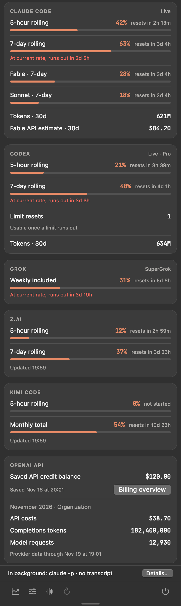
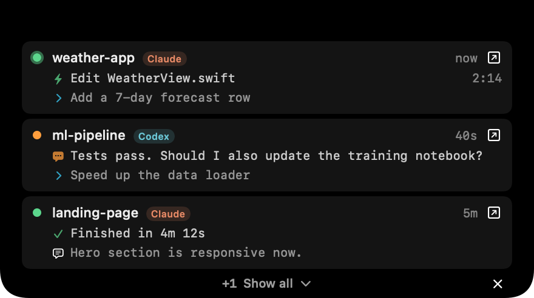
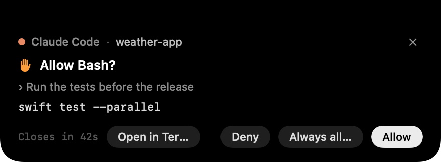
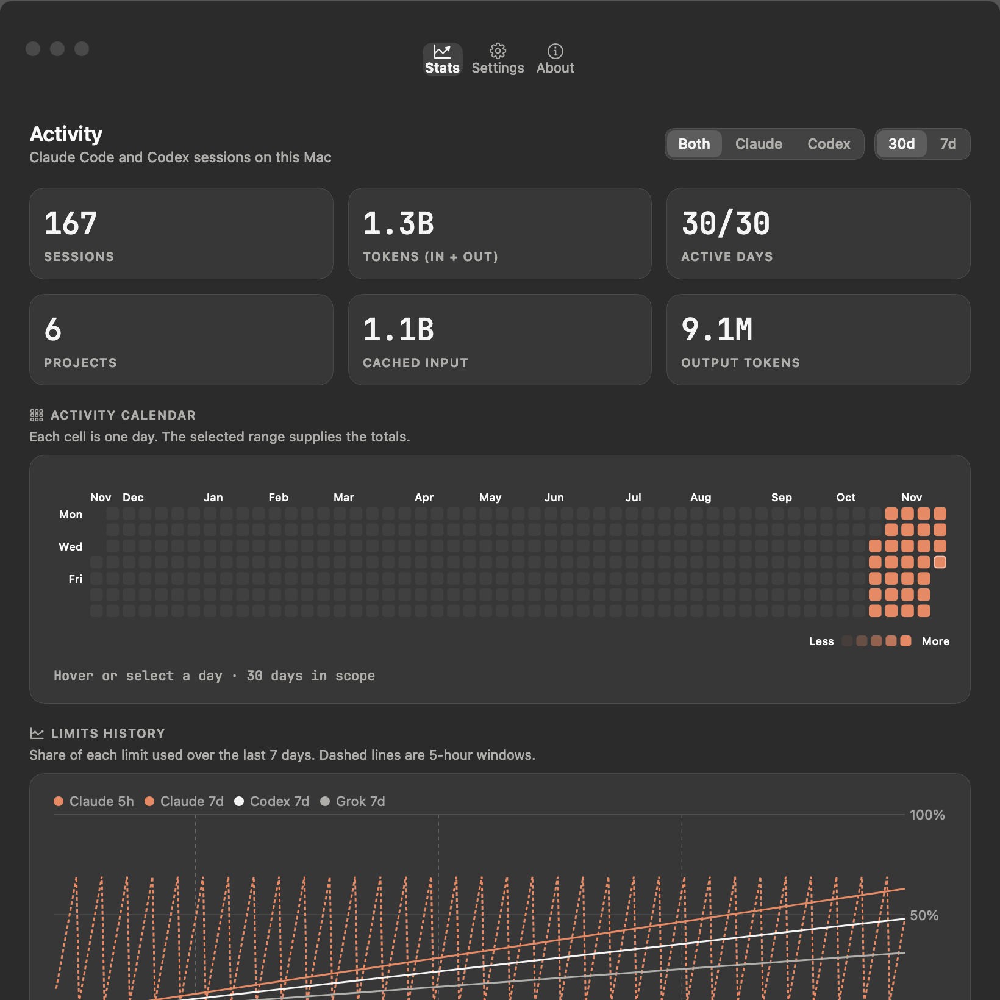
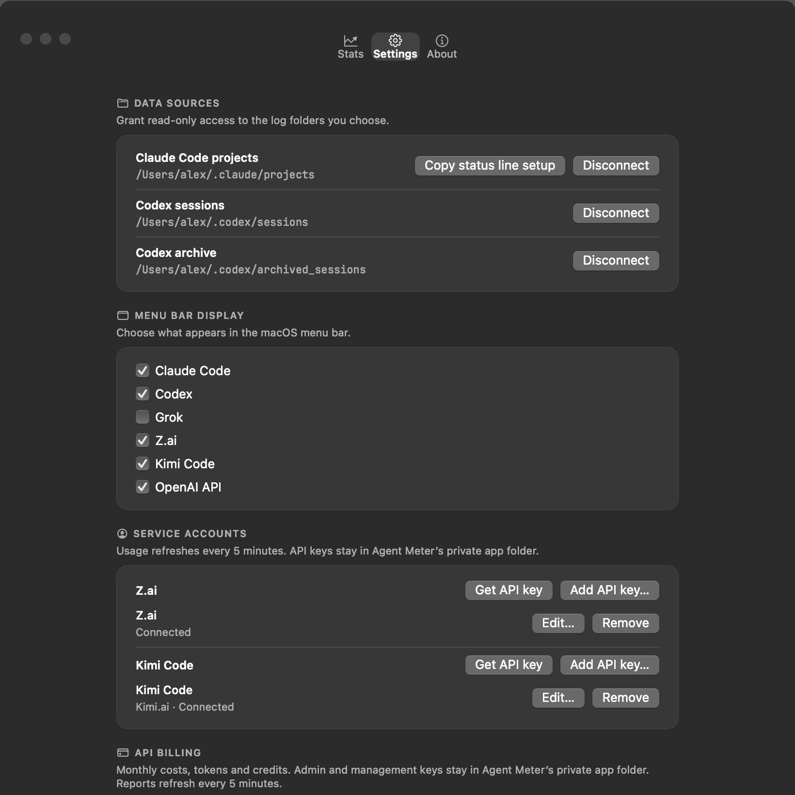
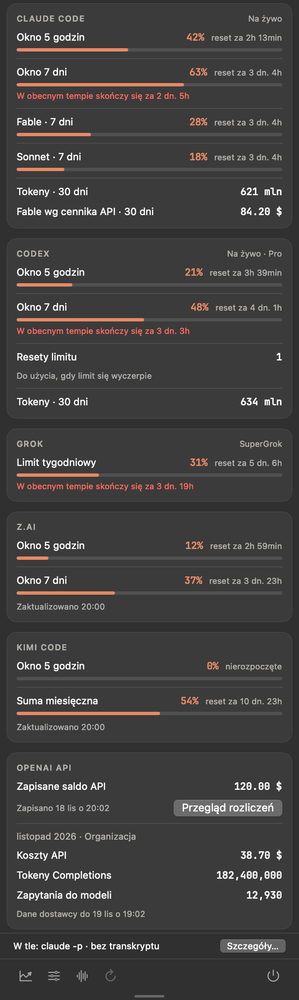
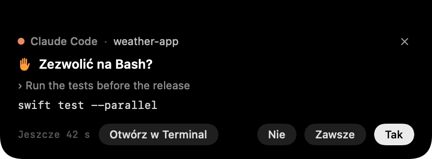

<p align="center">
  
</p>

<h1 align="center">Agent Meter</h1>

<p align="center">
  Claude, Codex and Grok limits in the macOS menu bar.<br>
  Session stats, background agents and a notch that answers agent prompts.
</p>

<p align="center">
  <a href="https://github.com/kpeeem/agent-meter/releases/latest"></a>
  <a href="https://github.com/kpeeem/agent-meter/actions/workflows/release.yml"></a>
  
  
</p>

<p align="center"><b>English</b> · <a href="README.ru.md">Русский</a></p>

> **TL;DR** — Download the zip from [Releases](https://github.com/kpeeem/agent-meter/releases/latest), move the app to `/Applications`, clear the quarantine, open it and point **Settings → Data sources** at `~/.claude/projects` and `~/.codex/sessions`. Agent Meter only reads local files, never starts Claude Code or calls Claude, keeps API keys on your Mac and sends no telemetry.

<table>
  <tr>
    <td width="45%"></td>
    <td>
      <br><br>
      
    </td>
  </tr>
</table>

## What it shows

| | |
| --- | --- |
| **Limits** | Claude 5-hour, weekly, Fable and per-model windows · live Codex limits and resets · Grok weekly pool · Z.ai and Kimi Coding Plans |
| **API spend** | OpenAI, Anthropic and xAI month-to-date cost, tokens, credits and spending limit |
| **Menu bar** | Rotates the windows every 3 seconds; pick what shows in Settings |
| **Stats** | Sessions, tokens, a year-long calendar, limit history, top projects, hidden background work |
| **Notch** | Live session list; cards when a turn ends, fails or waits; **Allow / Deny / Always allow** and answers to Claude's questions right from the notch |
| **Claudometer** | Pushes the same numbers to [Claudometer](https://github.com/kpeeem/claudometer), an ESP32-S3 e-paper board, over Bluetooth LE |
| **Languages** | English, Русский, Polski, picked from the macOS language |



## Claudometer

<a href="https://github.com/kpeeem/claudometer"></a>

The same limits on a 4.2″ e-paper board on your desk. Agent Meter feeds it over Bluetooth, so the board holds no tokens. Firmware, flashing and the printable case: [kpeeem/claudometer](https://github.com/kpeeem/claudometer).

## Install

**Release build** — download `Agent-Meter-<version>.zip`, unzip, move **Agent Meter** to `/Applications`, then:

```bash
xattr -dr com.apple.quarantine "/Applications/Agent Meter.app"
```

The build is ad-hoc signed, not notarized, so macOS blocks it until the quarantine flag is gone.

**From source** — macOS 14+ and Xcode, no dependencies:

```bash
git clone https://github.com/kpeeem/agent-meter.git && cd agent-meter
./scripts/build-app.sh && open "build/Agent Meter.app"
```

## Set up

1. Click the slider icon at the bottom of the panel to open **Settings**.
2. **Data sources** → connect `~/.claude/projects` and `~/.codex/sessions` (read-only, sandboxed).
3. Optional extras below.



<details>
<summary><b>Claude limits</b></summary>

Agent Meter reads only what Claude Code and Claude Desktop already write: `~/.claude/quota-live.json` (rate-limit headers, written by the `quota-live` mod), Claude Desktop's `plan-usage-history.json`, the status line snapshot and the Claude Statistics cache. **Copy status line setup** gives a `statusLine` entry for Claude Code settings; keep your own status line by piping the same JSON to both commands.
</details>

<details>
<summary><b>Live Codex and Grok limits</b></summary>

**Settings → Codex and Grok limits** copies a command that installs `AgentMeterRefresh`, a helper outside the sandbox. While Agent Meter is open it asks `chatgpt.com` for Codex limits with your Codex sign-in, and reads the Grok weekly pool through the Grok Bot session. That Grok endpoint is unofficial. Only percentages and dates reach the app. Remove it with `--uninstall`.
</details>

<details>
<summary><b>Service accounts and API billing</b></summary>

Add Z.ai or Kimi Coding Plan keys under **Service accounts**, and OpenAI or Anthropic admin keys or an xAI management key under **API billing**. Keys live in a `0600` file inside the app's sandbox container, and usage refreshes every 5 minutes.
</details>

<details>
<summary><b>Notch notifications</b></summary>

**Settings → Notch notifications** copies an install command for Claude Code or Codex hooks. Cards show the project, prompt, last answer or command. Approvals and questions wait up to 280 s for your answer, then fall back to the usual terminal prompt. Background runs (subagents, Guardian, `claude -p`, `codex exec`) are listed with a badge and don't pop up unless you ask.
</details>

<details>
<summary><b>Background agents</b></summary>

**Settings → Background agents** installs a helper that lists Claude Code, Codex and MCP processes every 30 s, including runs that keep no transcript. It saves names, counts and memory, never command lines.
</details>

## Privacy

- Sandboxed app with read-only access to the folders you pick.
- No Claude requests, no telemetry, no auto-update, no plugin loader.
- Network goes only to the providers whose keys you add, at fixed endpoints.
- Claudometer gets percentages and reset times, never tokens or session text.

## Languages

The UI follows **System Settings → General → Language & Region**. Try another language without changing yours:

```bash
open "build/Agent Meter.app" --args -AppleLanguages "(ru)"
```

 

Strings live in `Sources/AgentMeter/Resources/Localizable.xcstrings`.

## Development

```bash
swift test
./scripts/build-app.sh
```

Pushing a `v*` tag that matches `CFBundleShortVersionString` makes GitHub Actions test the app, build it and attach `Agent-Meter-<version>.zip` to a release.

## Credits

Native layout, charts and typography adapted from [ContextBar](https://github.com/htahaozlu/context-bar). Claude and OpenAI menu bar marks from [Claude Statistics](https://github.com/sj719045032/claude-statistics). [JetBrains Mono](https://www.jetbrains.com/lp/mono/) font. Their licenses are in `Packaging/Licenses`.
