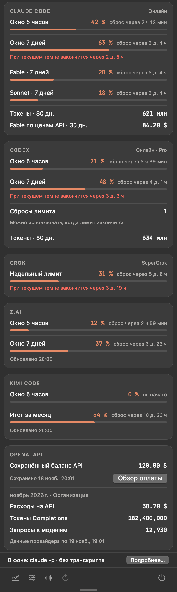
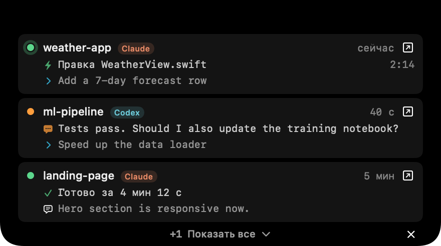
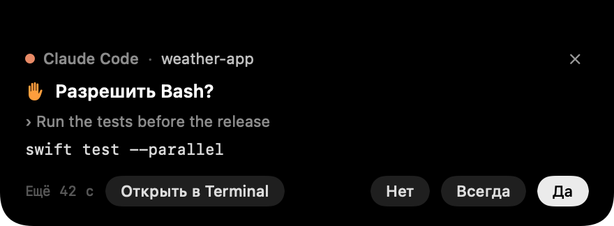
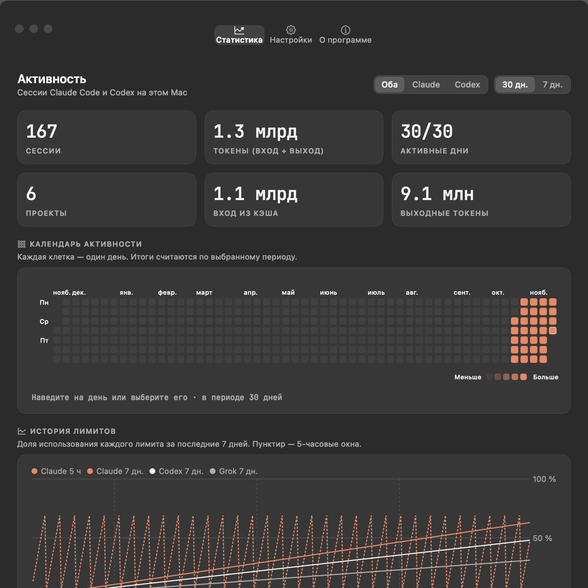
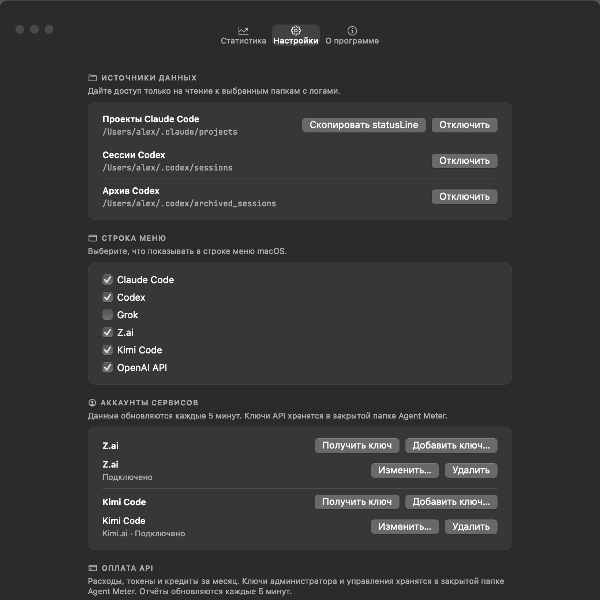
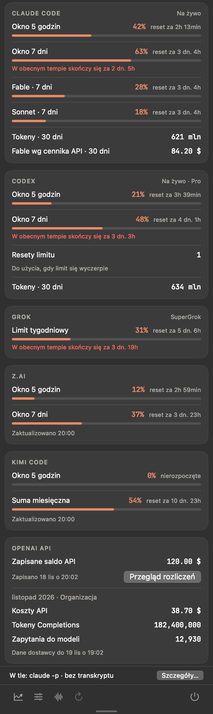
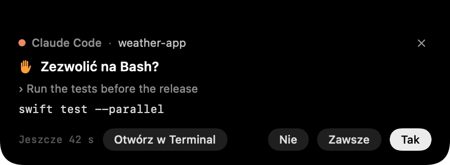

<p align="center">
  
</p>

<h1 align="center">Agent Meter</h1>

<p align="center">
  Лимиты Claude, Codex и Grok в строке меню macOS.<br>
  Статистика сессий, фоновые агенты и notch, который отвечает на запросы агентов.
</p>

<p align="center">
  <a href="https://github.com/kpeeem/agent-meter/releases/latest"></a>
  <a href="https://github.com/kpeeem/agent-meter/actions/workflows/release.yml"></a>
  
  
</p>

<p align="center"><a href="README.md">English</a> · <b>Русский</b></p>

> **TL;DR** — скачай zip из [Releases](https://github.com/kpeeem/agent-meter/releases/latest), перенеси приложение в `/Applications`, сними карантин, открой и укажи в **Настройки → Источники данных** папки `~/.claude/projects` и `~/.codex/sessions`. Agent Meter только читает локальные файлы, не запускает Claude Code и не обращается к Claude, хранит ключи API на твоём Mac и не шлёт телеметрию.

<table>
  <tr>
    <td width="45%"></td>
    <td>
      <br><br>
      
    </td>
  </tr>
</table>

## Что показывает

| | |
| --- | --- |
| **Лимиты** | Окна Claude на 5 часов и неделю, Fable и отдельные модели · живые лимиты и сбросы Codex · недельный пул Grok · Coding Plan от Z.ai и Kimi |
| **Расходы API** | OpenAI, Anthropic и xAI: стоимость с начала месяца, токены, кредиты и лимит расходов |
| **Строка меню** | Окна сменяются каждые 3 секунды, набор выбирается в настройках |
| **Статистика** | Сессии, токены, календарь за год, история лимитов, топ проектов, скрытая фоновая работа |
| **Notch** | Список сессий; карточки, когда ход закончен, упал или ждёт; **Да / Нет / Всегда** и ответы на вопросы Claude прямо из notch |
| **Табло лимитов** | Те же цифры по Bluetooth LE на табло с электронной бумагой |
| **Языки** | English, Русский, Polski — по языку macOS |



## Установка

**Готовая сборка** — скачай `Agent-Meter-<версия>.zip`, распакуй, перенеси **Agent Meter** в `/Applications` и выполни:

```bash
xattr -dr com.apple.quarantine "/Applications/Agent Meter.app"
```

Сборка подписана ad-hoc без нотаризации, поэтому macOS не откроет её, пока стоит флаг карантина.

**Из исходников** — macOS 14+ и Xcode, без зависимостей:

```bash
git clone https://github.com/kpeeem/agent-meter.git && cd agent-meter
./scripts/build-app.sh && open "build/Agent Meter.app"
```

## Настройка

1. Значок с ползунками внизу панели открывает **Настройки**.
2. **Источники данных** → подключи `~/.claude/projects` и `~/.codex/sessions` (только чтение, в песочнице).
3. Остальное — по желанию, ниже.



<details>
<summary><b>Лимиты Claude</b></summary>

Agent Meter читает только то, что уже пишут Claude Code и Claude Desktop: `~/.claude/quota-live.json` (заголовки лимитов, его пишет мод `quota-live`), `plan-usage-history.json` из Claude Desktop, снимок строки статуса и кэш Claude Statistics. **Скопировать statusLine** даёт запись `statusLine` для настроек Claude Code. Свою строку статуса можно сохранить: передай тот же JSON обеим командам.
</details>

<details>
<summary><b>Живые лимиты Codex и Grok</b></summary>

**Настройки → Лимиты Codex и Grok** копирует команду установки `AgentMeterRefresh` — помощника вне песочницы. Пока Agent Meter открыт, он спрашивает лимиты Codex у `chatgpt.com` с твоим входом в Codex и читает недельный пул Grok через сессию Grok Bot. Этот API Grok неофициальный. В приложение попадают только проценты и даты. Удаление — та же команда с `--uninstall`.
</details>

<details>
<summary><b>Аккаунты сервисов и оплата API</b></summary>

Ключи Coding Plan от Z.ai и Kimi добавляются в **Аккаунты сервисов**, ключи администратора OpenAI и Anthropic или ключ управления xAI — в **Оплата API**. Ключи лежат в файле с правами `0600` в контейнере песочницы, данные обновляются каждые 5 минут.
</details>

<details>
<summary><b>Уведомления в notch</b></summary>

**Настройки → Уведомления в notch** копирует команду установки хуков для Claude Code или Codex. Карточка показывает проект, запрос, последний ответ или команду. Подтверждения и вопросы ждут ответа до 280 секунд, потом уходят в обычный диалог терминала. Фоновые запуски (субагенты, Guardian, `claude -p`, `codex exec`) стоят в списке с бейджем и не всплывают, пока это не включено.
</details>

<details>
<summary><b>Фоновые агенты</b></summary>

**Настройки → Фоновые агенты** ставит помощника, который каждые 30 секунд собирает процессы Claude Code, Codex и MCP, включая запуски без транскрипта. Он сохраняет названия, количество и память, но не командные строки.
</details>

## Приватность

- Приложение в песочнице, доступ только на чтение к выбранным папкам.
- Ни запросов к Claude, ни телеметрии, ни автообновления, ни загрузки плагинов.
- Сеть — только к провайдерам, чьи ключи ты добавил, по фиксированным адресам.
- Табло получает проценты и время сброса, без токенов, имён проектов и текста сессий.

## Языки

Язык интерфейса берётся из **Системные настройки → Основные → Язык и регион**. Проверить другой язык, не меняя системный:

```bash
open "build/Agent Meter.app" --args -AppleLanguages "(pl)"
```

 

Строки лежат в `Sources/AgentMeter/Resources/Localizable.xcstrings`.

## Разработка

```bash
swift test
./scripts/build-app.sh
```

Тег `v*`, совпадающий с `CFBundleShortVersionString`, запускает GitHub Actions: тесты, сборку и релиз с `Agent-Meter-<версия>.zip`.

## Благодарности

Нативная разметка, графики и типографика взяты из [ContextBar](https://github.com/htahaozlu/context-bar). Значки Claude и OpenAI в строке меню — из [Claude Statistics](https://github.com/sj719045032/claude-statistics). Шрифт [JetBrains Mono](https://www.jetbrains.com/lp/mono/). Их лицензии лежат в `Packaging/Licenses`.
